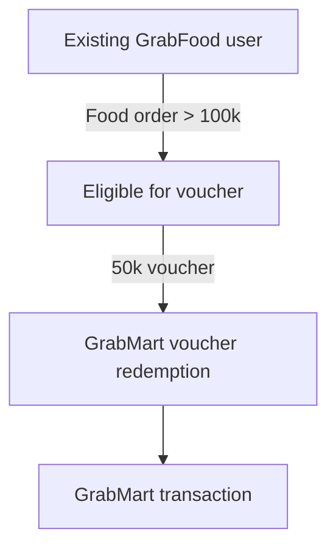

# Summary

## Tình huống

1.  Ứng Dụng: GrabMart
    - Chương trình khuyến mãi: Cross-sell mega promo (chương trình khuyến mãi chéo quy mô lớn)
    - Khoảng tgian thi triển: 6 tuần
    - Địa diểm: Thành Phố Hồ Chí Minh
    - Trạng Thái: thí điểm

2. Merchanism:
    Khi đặt đơn hàng trên `GrabFood`:
    constraints:
        - tổng giá trị > 100.000 vnđ -> nhận voucher trị giá 50.000 vnđ cho `GrabMart` tiếp theo

3. Output - Backlog Test:
    - Tổng giá trị giao dịch (GMV):
        + GrabMart và GrabFood: đều tăng hơn 45% (so với ?)

4. Deployment:
    - Triển khai chính thức tại Hà Nội (với ngân sách khủng)

5. Work-to-do: đưa ra đánh giá -- và phân tích răng có hợp lí để deploy ở Hà Nội không ?

    Tình huống:

        Giám đốc Quốc gia tin rằng chiến dịch này đã thành công trong việc thay đổi hành vi người dùng và 
        hình thành thói quen sử dụng đa dịch vụ.

    Câu hỏi:
        
        - Dựa trên dữ liệu chuyên sâu về hành vi và kết quả kinh doanh (P&L), bạn có đồng ý với nhận định này không?
        - Yếu tố thực sự nào đang thúc đẩy mức tăng trưởng 45% đó? 
        - Hãy xây dựng lập luận dựa trên dữ liệu và đưa ra khuyến nghị cuối cùng về việc có nên mở rộng chương trình này sang Hà Nội hay không 

# Background-Analysis

### Acquisition Funnel

`query_path`: [acquisition_funnel](query/acquisition_funnel.sql)

**Hypothesis:**

`45% GMV growth` của Food có thể được campaign kích hoạt từ existing Food users -- vì mechanic bắt đầu từ một `Food order >100k`



| Metric                            | Ý nghĩa                                                 |
| --------------------------------- | ------------------------------------------------------- |
| **Food eligibility rate**         | % Food users/orders đủ điều kiện                        |
| **Voucher redemption rate**       | % eligible users thực sự redeem voucher                 |
| **Mart acquisition rate**         | % Food users được campaign chuyển thành Mart users      |
| **Voucher-driven Mart GMV share** | Mart GMV đến từ transaction có voucher / total Mart GMV |
| **Voucher-driven GMV uplift**     | incremental GMV nếu có thể establish baseline/control   |


_result:_ 


| |metric | value |
--|-------|-------|
0|food_users|4999.00|
1|eligible_food_users|4991.00|
2|voucher_redeemers|4446.00|
3|campaign_acquired_users|4441.00|
4|food_eligibility_rate|99.84|
5|voucher_redemption_rate|89.08|
6|campaign_acquisition_rate|88.84|


---
### % voucher-driven transaction int Total-GMV
---
>Trong 45% growth của GMV (both Mart/Food) thì bao nhiêu phần trăm đến từ voucher của Mart

`sql_path`: [percentage-voucher-driven-transaction](query/percentage_voucher_driven_transaction.sql)

_result_:


| |metric|value|
|-|------|-----|
0|total_mart_gmv|1792132.50
1|voucher_mart_gmv|781755.20
2|voucher_gmv_share|43.62


---
### Acquisition-Funnel (Deeper Layer)
---
>Trong số user/GMV của GrabMart trong Promo period, campaign thực sự mang vào bao nhiêu user mới so với những người vốn đã là Mart user?

Structure song song:

```
Promo-period GrabMart users
│
├── Existing Mart User
│   └── đã từng dùng Mart trước campaign
│
└── New Mart User
    └── first_mart_order_date bắt đầu trong/đúng thời điểm promo
```
sau đó -- `New-Mart` sẽ tiếp tục spill:
```
New Mart Users
│
├── Cross-sell acquired
│   └── is_cross_sell_voucher = 1
│
└── Non-cross-sell
```
`sql_path`: [acquisition-funnel-inc-user-type](query/acquisition_funnel_inc_user_type.sql)


__Result__:


| mart_user_type | users | user_share | cross_sell_users | cross_sell_user_rate | mart_gmv | gmv_share | cross_sell_gmv | cross_sell_gmv_share | gmv_per_user |
| --- | --- | --- | --- | --- | --- | --- | --- | --- | --- |
| New Mart User | 643 | 13.24 | 643 | 100.00 | 240,164.6 | 13.4 | 111,391.1 | 46.38 | 373.51 |
| Existing Mart User | 4,215 | 86.76 | 3,804 | 90.25 | 1,551,967.9 | 86.6 | 670,364.1 | 43.19 | 368.20 |


## Finding#1:

```bash
Campaign
   │
   ├── Voucher adoption: HIGH
   │       89.08% Food users
   │
   ├── New Mart acquisition: EXISTS
   │       643 users
   │       13.24% Mart users
   │
   └── Existing Mart users:
           86.76% Mart users
           43.19% GMV cross-sell share
```

Hypothesis hình thành là:

>Campaign clearly generated cross-sell activity and acquired a measurable group of new Mart users, but the majority of Promo-period Mart users and GMV still came from existing Mart users.

Đặc biệt mình muốn kiểm tra 2 things:
- 643 New Mart Users này đóng góp bao nhiêu vào incremental growth so với baseline?
- Sau khi campaign kết thúc ở Week 13–14, 643 users này có tiếp tục dùng Mart không?

> Nếu họ tiếp tục → evidence cho habit formation.
>
> Nếu họ biến mất ngay sau Promo → evidence cho promo-driven temporary acquisition.


---
### Remarkable the Storyline until we get things up

--- 

```bash

                    45% GMV Growth
                          │
                          ▼
                 ┌─────────────────┐
                 │ Cross-sell works │
                 └────────┬────────┘
                          │
                    643 New Mart     <---- We are here :"> hehe
                       13.24%
                          │
             ┌────────────┴────────────┐
             │                         │
       How much did they          Do they retain?
       contribute to uplift?      Week 13–14?
             │                         │
             ▼                         ▼
       Growth attribution       Habit formation
             │                         │
             └────────────┬────────────┘
                          ▼
                Is 45% sustainable?
                          │
                          ▼
                   Hanoi decision

```


---
### How much New Mart contribute to the uplift -- Test in this cohort

---

1. Phân rã Uplift theo tệp người dùng (user-segmentation) (Done)
2. Phân rã theo hành vi giỏ hàng (basket behavior and gaming)

    **- Hành vi kéo giỏ hàng: trung bình đơn Food trước đây của người dùng là 70-80k. Nhờ promo, họ cố mua thêm để bill nhảy lên mức > 100k. Giải thích được vì sao GMV cũng tăng**

    `query_path`: [basket-behavior](query/basket_behavior.sql)

    _Result_:

    | Period | Total Food Orders | AOV (VND '000) | < 80K (%) | 80K - 99.9K (%) | 100K - 119.9K (%) | >= 120K (%) |
    | --- | --- | --- | --- | --- | --- | --- |
    | **Pre-Promo** | 4,056 | 133.8 | 11.8 | 14.6 | 19.7 | 53.9 |
    | **Promo** | 9,555 | 115.4 | 8.1 | 9.9 | 50.7 | 31.3 |

    
    **- Hành vi của cùng 1 tệp khách hàng (trước và trong khi diễn ra promo)**

    `query_path`: [same_user_behavior](query/same_user_behavior.sql)

    _Result_:

    | Total Tracked Users | User AOV Pre-Promo | User AOV During Promo | Avg Uplift Per User | Users Crossing Threshold (%) |
    | --- | --- | --- | --- | --- |
    | 4,985 | 130.2 | 118.2 | -12.0 | 5.8 |

    
    **- Hành vi chẻ đơn: Người dùng muốn đặt 300k, thay vì đặt 1 đơn -- thì chia làm 3 để lấy 3 vouchers. GMV Food tăng về số lượng đơn nhưng chi phí khuyến mãi (Promo cost) bị nhân lên gấp 3 --> loss in PnL**

    `query_path`: [order-splitting](query/order_splitting.sql)

    _Result_:
    Metric | Pre-Promo | Promo | % Change |
    | --- | --- | --- | --- |
    | **Cohort Size** | 4,985 | 4,985 | - |
    | **Avg Orders per User** | 8.14 | 19.15 | **+135.3%** |
    | **Avg GMV per User** | 1,088.9 | 2,210.0 | **+103.0%** |
    | **Avg GMV per Order (AOV)** | 130.2 | 118.2 | **-9.2%** |


Đúng. **Metric `qualification_order` này làm cho lập luận về incentive-driven splitting mạnh hơn một bước**, vì nó nối trực tiếp giữa **transaction fragmentation** và **điều kiện để nhận voucher**.

Nếu definition là:

```sql
item_subtotal > 100
```

thì bạn đang đo:

> Số order đủ điều kiện để nhận cross-sell voucher.

Và nếu **Promo tăng +162% so với Pre-Promo**, trong khi trước đó ta đã thấy:

* Orders/user: **+135.3%**
* AOV: **-9.2%**
* Orders tập trung mạnh ở vùng **100–119.9K**
* **5.8%** tracked users chuyển từ AOV `<100K` → `>=100K`
* New Mart users: **100% sử dụng cross-sell voucher**

thì các evidence bắt đầu nối thành một chain khá rõ:

```text
                PROMO INCENTIVE
                      │
                      ▼
              Qualification
              order > 100K
                      │
                +162% orders
                      │
          ┌───────────┴───────────┐
          │                       │
    Basket threshold         More transactions
       shifting                   │
          │                       │
          └───────────┬───────────┘
                      ▼
               Voucher usage
                      │
                      ▼
             GMV / transaction
                 expansion
```

### Điểm rất quan trọng

Mình sẽ **không chỉ nói "splitting order tăng 162%"**.

Vì `qualification_order` tăng 162% tự nó chỉ nói:

> **Số order đạt điều kiện voucher tăng mạnh.**

Nhưng khi đặt cạnh:

> **Orders/user +135.3% và AOV/order -9.2%**

thì argument trở nên mạnh hơn:

> **The increase in transaction frequency was disproportionately concentrated in orders meeting the >100K voucher threshold, strongly suggesting that the additional transactions were incentive-driven rather than purely organic demand expansion.**

Đây là wording mình thấy **defensible nhất**.

---
**Finding 1 - Acquisition exists, but is not the main scale driver**

* New Mart = **13.24%** of Promo Mart users
* New Mart = **13.4%** of Mart GMV
* 100% New Mart users used cross-sell voucher

→ Campaign **did acquire new Mart users**, nhưng scale chưa đủ để giải thích toàn bộ uplift.

**Finding 2 - Existing users materially changed transaction behaviour**

* Orders/user: **+135.3%**
* GMV/user: **+103.0%**
* AOV/order: **-9.2%**

→ Growth đến nhiều từ **frequency**, không phải đơn hàng lớn hơn.

**Finding 3 - The additional transactions are closely tied to voucher qualification**

* Qualification orders (`item_subtotal > 100K`): **+162%**
* Strong shift toward `100–119.9K`
* 5.8% users crossed from `<100K` → `>=100K`

**Finding 4: GMV growth strong but contribution margin is turning into negative**

> Food is "fund" growth but Mart is destroying margin.

The campaign successfully stimulated cross-service transactions, but the observed GMV uplift appears materially driven by incentive-induced transaction behaviour, and this incremental volume came at a significant contribution-margin cost.


The campaign generated substantial incremental transaction volume and GMV, but the economics deteriorated materially. GrabFood contribution margin increased by 149M, while GrabMart contribution margin declined by 655M, resulting in a net 506M deterioration in contribution margin. Under the analytical P&L assumptions, GrabMart margin per order shifted from +4.5K to -25.0K during Promo. This indicates that the GMV uplift was purchased at a significant margin cost rather than translating proportionally into profitable growth.

