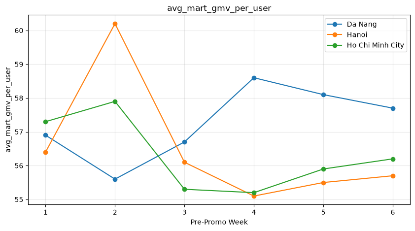
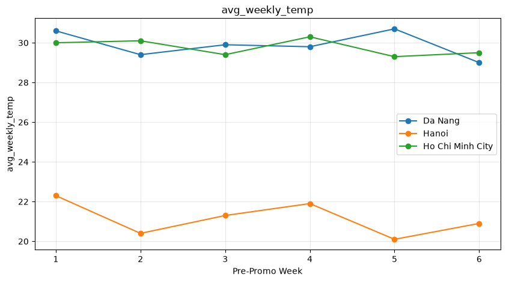
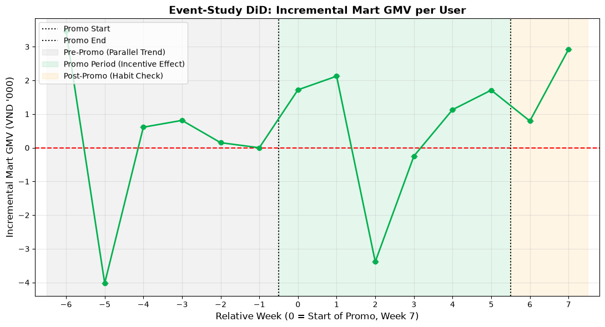
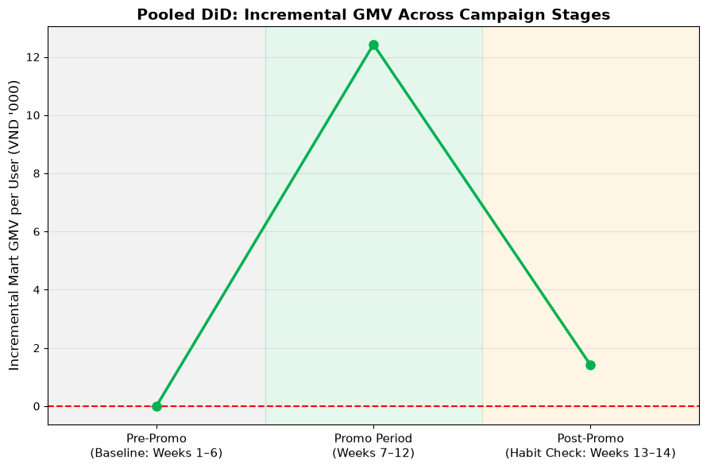

# Q3. Should Grab expand the campaign to Hanoi?

### **Recommendation: No - not in its current form.**

The campaign successfully generated **incremental Mart GMV during the promotional period**, but the available evidence does not yet support the conclusion that this uplift represents **sustainable behavioural growth**.

Our recommendation is therefore **not to scale the current campaign mechanic to Hanoi until the durability and economics of the incremental growth are proven.**

---

## 1. HCMC is the treatment market. Hanoi is the most suitable comparison market

We evaluated Hanoi and Da Nang as potential comparison markets using pre-promotion trends.

Da Nang was excluded because its pre-promotion **Mart GMV per user** trajectory moved in a materially different direction from HCMC, making it unsuitable under the parallel-trend requirement.

Hanoi showed a substantially more comparable pre-promotion Mart GMV trajectory and was therefore retained as the comparison market.




We also considered **weekly temperature as an external factor** that could influence demand and incorporated it as a control variable rather than attributing weather-driven variation to the campaign.




---

## 2. The campaign clearly generated short-term incremental Mart GMV

Two complementary DiD approaches were used.

### Event-study DiD



The event-study estimates the incremental effect separately for each relative week.

This provides a granular view of how the campaign effect evolved over time, but the weekly estimates are naturally noisier because each week is estimated separately.

The result shows a **positive incremental effect during the promotional period**, but the magnitude fluctuates considerably across weeks.

After the campaign ends, the incremental effect moves substantially back toward the baseline.

### Pooled DiD



The pooled specification aggregates the six promotional weeks and estimates **one overall treatment effect**.

This provides a more stable estimate of the campaign's average incremental Mart GMV effect during Promo and is therefore the appropriate estimate to use when translating the campaign effect into incremental GMV / P&L impact.

The pooled result confirms that the campaign generated **positive incremental Mart GMV during Promo**.

---

# 3. However, the uplift does not appear to persist after the incentive ends

This is the key finding for the sustainability question.

The campaign produces:

> **Positive incremental Mart GMV during Promo**

but:

> **The effect declines substantially toward the pre-promotion baseline after Promo.**

Therefore, while we have evidence that the campaign can **stimulate Mart demand**, we do **not find strong evidence of persistent habit formation** within the observed post-promo period.

> **“We do not find strong evidence that the promotional uplift translates into a durable shift in Mart purchasing behaviour.”**

This distinction is important because the post-promo observation window is limited.

---

# 4. Behavioural evidence provides a plausible explanation for the temporary uplift

The DiD result is consistent with the behavioural findings from the same cohort.

During Promo:

* **Orders per user: +135.3%**
* **GMV per user: +103.0%**
* **AOV per order: -9.2%**
* **Qualifying orders (>100K): +162%**
* **5.8%** of tracked users moved from below the 100K threshold pre-promo to ≥100K during Promo.

This pattern is more consistent with:

> **incentive-induced transaction expansion**

than with users simply developing a stronger underlying preference for GrabMart.

In particular, the combination of:

```text
Orders / User        ↑↑
Qualifying Orders    ↑↑
AOV / Order          ↓
```

provides strong evidence that the voucher threshold influenced transaction behaviour.

We have **strong evidence of increased qualifying transactions**, and **order splitting is a highly plausible mechanism**. However, we should not yet attribute the entire uplift specifically to splitting, because the basket-level analysis still needs to distinguish between:

* order splitting,
* genuine basket expansion / bundling,
* and genuinely incremental orders.

Therefore, the safer conclusion is:

> **The incremental growth appears to be materially driven by incentive-induced transaction behaviour, with strong evidence of increased qualifying transactions.**

---

# 5. This is also consistent with the P&L result

The behavioural uplift does not translate proportionally into healthier economics.

Under our analytical contribution-margin assumptions:

### GrabMart

```text
Contribution Margin
+64.8M → -590.6M
```

and:

```text
Margin / Order
+4.5K → -25.0K
```

So the campaign successfully generated more Mart GMV, but the additional volume came with a substantial economic cost.

This reinforces the distinction between:

> **incremental GMV**

and

> **incremental healthy growth.**

---

# 6. Final recommendation

### **Do not scale the current campaign mechanic to Hanoi yet.**

This is **not because the campaign failed**.

It successfully stimulated Mart demand and generated measurable incremental GMV during Promo.

The issue is that we have not established that this growth is:

1. **Durable** — the uplift declines substantially after the campaign.
2. **Behaviourally healthy** — transaction-level evidence points toward incentive-driven qualifying behaviour.
3. **Economically attractive** — Mart contribution margin deteriorated materially during Promo.

Therefore:

> **Before expanding to Hanoi, Grab should redesign or optimize the incentive mechanism to distinguish genuine incremental Mart adoption from promo-induced transaction expansion, and then validate whether acquired behaviour persists after the incentive is removed.**

---

### **Executive takeaway**

> **The campaign successfully generated short-term incremental Mart GMV, but the uplift appears materially incentive-driven and does not show strong evidence of persistence after the promotion. Given the associated deterioration in Mart unit economics, we would not recommend scaling the current mechanic to Hanoi until durable behaviour and positive incremental economics are demonstrated.**
