# Presentation--Slide Flow

## 1. Goes through the Question

1. Summary the Question
2. Finding: The Principle
3. Listing the Main-Problem

## 2. Material Reviewing;

1. Review Meta-data
    - Read the documentation about the metadata and database given
    - Try to execute sample-query given -- to gain insights 
        - knowing logic define the new-existed `grab-mart` customer
        - profit calculation and loss calculation $\rightarrow$ can draft a sample PnL
        - Understanding pain-point and drafting-workflow analyse
2. Background Analyse:

    - Total GMV of each kind of customer segmentation
    - Create Assumption in definition (since i dont know much about the `new-merchant`)
    - Approaches Selection 
        - Difference in Differences (acknowledgement from friend co-researchers)

## 3. Analyse-into each questions:

### 3.1: From Awareness to Real-Root Cause Identification:

```mermaid
flowchart TD

    %% =========================================================
    %% MAIN QUESTION
    %% =========================================================

    Q([Business Question:<br/>
    What is really driving the ~45% GMV uplift<br/>
    and is it sustainable enough to scale to Hanoi?])

    DATA[(Transaction + Merchant + Weather Data)]

    Q --> DATA


    %% =========================================================
    %% 1. CAMPAIGN MECHANISM
    %% =========================================================

    subgraph S1["1. Understand Campaign Mechanism"]
        direction TB

        F[Existing GrabFood User]

        F -->|Food order >= 100K| E[Voucher Eligible]

        E -->|50K GrabMart Voucher| R[Voucher Redeemed]

        R --> M[GrabMart Transaction]

        M --> GMV[GrabMart GMV]
    end

    DATA --> S1


    %% =========================================================
    %% 2. FIRST DECOMPOSITION — ACQUISITION
    %% =========================================================

    subgraph S2["2. Decompose GMV Uplift — User Acquisition"]
        direction TB

        U[Promo-period Mart Users]

        U --> EU[Existing Mart Users]
        U --> NU[New Mart Users]

        NU --> CS[Cross-sell Acquired]
        NU --> NCS[Non Cross-sell]

        CS --> NUGMV[New Mart User GMV]
        EU --> EUGMV[Existing Mart User GMV]
    end

    GMV --> U

    %% Key conclusion
    NUGMV --> C1{Is New Mart Acquisition<br/>enough to explain uplift?}

    C1 -->|No — New users are only<br/>a limited share of Mart GMV| BEHAVIOR
    C1 -->|Yes| RETENTION


    %% =========================================================
    %% 3. SECOND DECOMPOSITION — BEHAVIOR
    %% =========================================================

    subgraph S3["3. Identify the Behaviour Behind the Uplift"]
        direction TB

        BEHAVIOR[Behavioural Decomposition]

        BEHAVIOR --> B1[Basket Upsizing]
        BEHAVIOR --> B2[Same-user AOV Behaviour]
        BEHAVIOR --> B3[Order Frequency]
        BEHAVIOR --> B4[Order Splitting / Gaming]

        B1 --> T[Food Basket Tiering]

        T --> T1["< 80K"]
        T --> T2["80K - 99.9K"]
        T --> T3["100K - 119.9K"]
        T --> T4[">= 120K"]

        B2 --> COHORT[Same Users:<br/>Present Pre + Promo]

        COHORT --> AOV[Compare AOV<br/>Pre vs Promo]

        AOV --> CROSS{Pre < 100K<br/>AND Promo >= 100K?}

        CROSS -->|Yes| CROSSU["5.8% Users<br/>Crossed Threshold"]
        CROSS -->|No| NOCHANGE[No Threshold Change]

        B3 --> ORDERS["Orders / User<br/>+135.3%"]

        B4 --> SPLIT["Order Splitting Signal"]

        SPLIT --> QUAL["Qualifying Orders >100K<br/>+162%"]

        QUAL --> AOVDOWN["AOV / Order<br/>-9.2%"]
    end

    %% =========================================================
    %% 4. BEHAVIOURAL INTERPRETATION
    %% =========================================================

    CROSSU --> INT
    ORDERS --> INT
    QUAL --> INT
    AOVDOWN --> INT

    INT{What explains the uplift?}

    INT -->|Evidence points to<br/>incentive-driven transaction expansion| MECH
    INT -->|Need further item-level test| BUNDLE

    MECH[Order Splitting /<br/>Threshold-driven Behaviour]

    BUNDLE[Basket Expansion /<br/>Bundling]

    MECH --> PNL
    BUNDLE --> PNL


    %% =========================================================
    %% 5. ECONOMIC VALIDATION
    %% =========================================================

    subgraph S4["4. Validate Whether GMV Growth Creates Value"]
        direction TB

        PNL[P&L / Unit Economics]

        PNL --> FOOD[GrabFood]
        PNL --> MART[GrabMart]

        MART --> MG[Mart GMV<br/>+29.5%]

        MART --> MARGIN["Contribution Margin / Order<br/>+4.5K → -25.0K"]

        MART --> TOTALCM["Total Contribution Margin<br/>+64.8M → -590.6M"]

        MARGIN --> ECON{Is Incremental GMV<br/>Economically Healthy?}

        TOTALCM --> ECON

        ECON -->|No| VALUE["GMV Growth ≠<br/>Healthy Growth"]
        ECON -->|Yes| VALUEPOS[Positive Incremental Value]
    end

    %% =========================================================
    %% 6. SUSTAINABILITY / CAUSAL VALIDATION
    %% =========================================================

    subgraph S5["5. Test Sustainability of Mart GMV Uplift"]
        direction TB

        DID[Difference-in-Differences]

        DID --> CTRL[Control Group Validation]

        CTRL --> HCM[Ho Chi Minh City<br/>Treatment]
        CTRL --> HAN[Hanoi<br/>Candidate Control]

        CTRL --> DAN[Da Nang<br/>Rejected — violates trend validation]

        DID --> WEATHER[Weather as<br/>External Factor]

        HCM --> ES[Event Study]
        HCM --> PDID[Pooled DiD]

        ES --> PROMOES[Promo uplift<br/>week-by-week]
        PDID --> PROMOPDID[Single Promo Effect<br/>Preferred for P&L]

        PROMOES --> POST[Post-Promo]
        PROMOPDID --> POST

        POST --> BASELINE{Does Mart GMV<br/>remain above baseline?}

        BASELINE -->|Mostly fades toward baseline| NOHABIT["Weak evidence of<br/>Habit Formation"]
        BASELINE -->|Persistent uplift| HABIT["Evidence of<br/>Sustainable Shift"]
    end

    VALUE --> DID
    NOHABIT --> DECISION
    HABIT --> DECISION


    %% =========================================================
    %% 7. FINAL DECISION
    %% =========================================================

    subgraph S6["6. Strategic Decision"]
        direction TB

        DECISION{Is the observed uplift<br/>sustainable AND incremental?}

        DECISION -->|No| HOLD["DO NOT SCALE CURRENT<br/>MECHANIC TO HANOI"]

        DECISION -->|Yes| SCALE["Consider Hanoi Rollout"]

        HOLD --> NEXT[Redesign Incentive]

        NEXT --> TEST2[Re-test:<br/>• Splitting vs genuine basket growth<br/>• Post-promo retention<br/>• Incremental CM]

        TEST2 --> SCALE2[Re-evaluate Hanoi Expansion]
    end
```



### 3.2: Question-1:

### 3.3: Question-2:

### 3.4: Question-3:


### Mạch này khác flow cũ ở điểm quan trọng

Flow mới không còn kể câu chuyện kiểu:

> **Campaign → SQL analysis → metric → metric → decision**

mà kể đúng logic **“proof chain”**:

```text
45% GMV Uplift
       ↓
1. Is it acquisition?
       ↓
New Mart users are NOT enough
       ↓
2. Then what changed?
       ↓
Order frequency ↑
Qualifying orders ↑162%
AOV/order ↓
       ↓
3. What is the mechanism?
       ↓
Threshold-driven transaction expansion
+ strong splitting signal
       ↓
4. Does more GMV = more value?
       ↓
Mart Contribution Margin turns negative
       ↓
5. Is the uplift sustainable?
       ↓
DiD / Event Study
       ↓
Post-promo → near baseline
       ↓
Weak evidence of habit formation
       ↓
6. Should we scale to Hanoi?
       ↓
NO — optimize mechanic first
```

**Đặc biệt mình sẽ giữ một nuance quan trọng:** hiện tại mình sẽ gọi `Order Splitting / Threshold-driven Behaviour` là **strong behavioural explanation**, chứ chưa nói *“100% uplift comes from splitting”*. Vì `+162% qualifying orders` và `AOV -9.2%` là evidence rất mạnh, nhưng để khẳng định causal contribution của splitting vào từng phần của uplift thì mình vẫn nên có thêm decomposition trực tiếp ở transaction/order level.

Cái này sẽ làm story của bạn **chắc hơn rất nhiều khi bị Country Head / interviewer challenge**.
